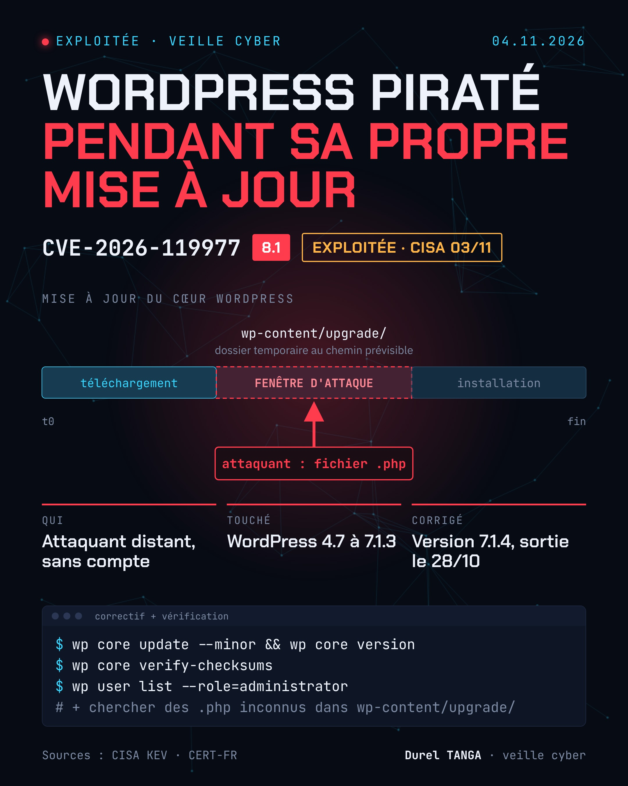

# CVE-2026-119977 : WordPress, exécution de code pendant la mise à jour du cœur

| | |
|---|---|
| Correctif publié | 28/10/2026 (WordPress 7.1.4) |
| Avis CERT-FR | 29/10/2026 |
| Ajout au catalogue KEV (CISA) | 03/11/2026 |
| Échéance CISA | 06/11/2026 |
| Sévérité | Haute, CVSS 8.1 |
| Type | Race condition (TOCTOU) |
| Exploitation | Oui, confirmée par la CISA |

## Le problème
Lors d'une mise à jour complète du cœur, WordPress utilise des dossiers temporaires accessibles depuis le web et au chemin prévisible. Pendant cette fenêtre, un attaquant non authentifié peut exécuter du code sur le serveur.

## Versions concernées
WordPress 4.7 à 7.1.3. Correctifs rétroportés sur les anciennes branches.

## Que faire
    # Mettre à jour puis vérifier la version
    wp core update --minor
    wp core version

    # Vérifier l'intégrité des fichiers du cœur
    wp core verify-checksums

    # Repérer un compte admin inconnu
    wp user list --role=administrator

Vérifier aussi l'absence de fichiers .php inconnus dans `wp-content/upgrade/`, et lancer un scan antimalware. Les mises à jour automatiques peuvent échouer sans alerte : contrôler la version à la main.

## Sources
- [CERT-FR (ANSSI) : CERTFR-2026-AVI-1420](https://cert.cyber.gouv.fr/avis/CERTFR-2026-AVI-1420/)
- [CISA : ajout au catalogue KEV du 03/11/2026](https://www.cisa.gov/news-events/alerts/2026/11/03/cisa-adds-one-known-exploited-vulnerability-catalog)
- [Fiche CVE officielle (cve.org)](https://www.cve.org/CVERecord?id=CVE-2026-119977)
