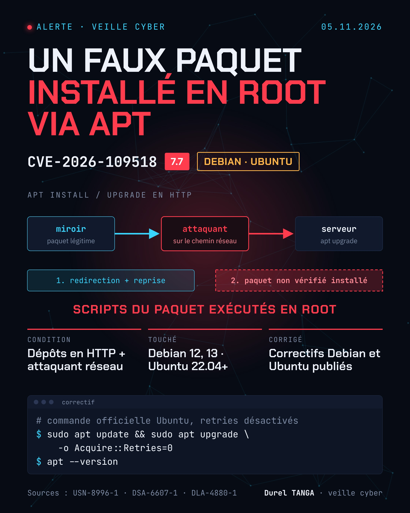

# CVE-2026-109518 : APT, installation d'un paquet non vérifié en root

| | |
|---|---|
| Avis Ubuntu | 04/11/2026 (USN-8996-1) |
| Avis Debian | DSA-6607-1 (Debian 13), DLA-4880-1 (Debian 12) |
| Sévérité | Haute, CVSS 4.0 : 7.7 |
| Produit | APT (Debian, Ubuntu et dérivées) |
| Exploitation | Aucune signalée |
| Découverte | Max Justicz |

## Le problème
APT gère mal les liens physiques (hard links) lorsqu'il suit une redirection puis relance un téléchargement. Un attaquant placé sur le chemin réseau, capable de modifier le trafic HTTP (miroir ou proxy malveillant par exemple), peut amener APT à installer un paquet non vérifié et obtenir une exécution de code en root.

## Conditions
- Dépôts en HTTP et attaquant sur le chemin réseau
- Option `Acquire::Retries` différente de 0 (valeur par défaut : 3 sur les versions récentes)
- Non concernés : dépôts HTTPS, paquets Snap

## Systèmes exposés par défaut
Debian 12 et versions ultérieures, Ubuntu 22.04 LTS et versions ultérieures. Les versions plus anciennes ne sont concernées que si les reprises ont été activées manuellement.

## Versions corrigées
| Distribution | APT corrigé |
|---|---|
| Debian 13 (trixie) | 3.0.4 |
| Debian 12 (bookworm) | 2.6.2 |
| Ubuntu 26.10 | 3.3.3ubuntu0.1 |
| Ubuntu 26.04 LTS | 3.2.1ubuntu0.1 |
| Ubuntu 24.04 LTS | 2.8.4ubuntu0.1 |
| Ubuntu 22.04 LTS | 2.4.15ubuntu0.1 |

## Que faire
Commandes recommandées par Ubuntu :

    # Mise à jour complète, reprises désactivées
    sudo apt update && sudo apt upgrade -o Acquire::Retries=0

    # Ou mise à jour d'APT seul
    sudo apt update && sudo apt install -o Acquire::Retries=0 --only-upgrade '?source-package(^apt$)'

    # Vérifier la version installée
    apt --version

Passer ses dépôts en HTTPS protège aussi contre cette faille.

## Sources
- [Ubuntu : USN-8996-1](https://ubuntu.com/security/notices/USN-8996-1)
- [Ubuntu : billet sur la faille APT](https://ubuntu.com/blog/apt-vulnerability-fixes-available)
- [Debian Security Tracker : CVE-2026-109518](https://security-tracker.debian.org/tracker/CVE-2026-109518)
