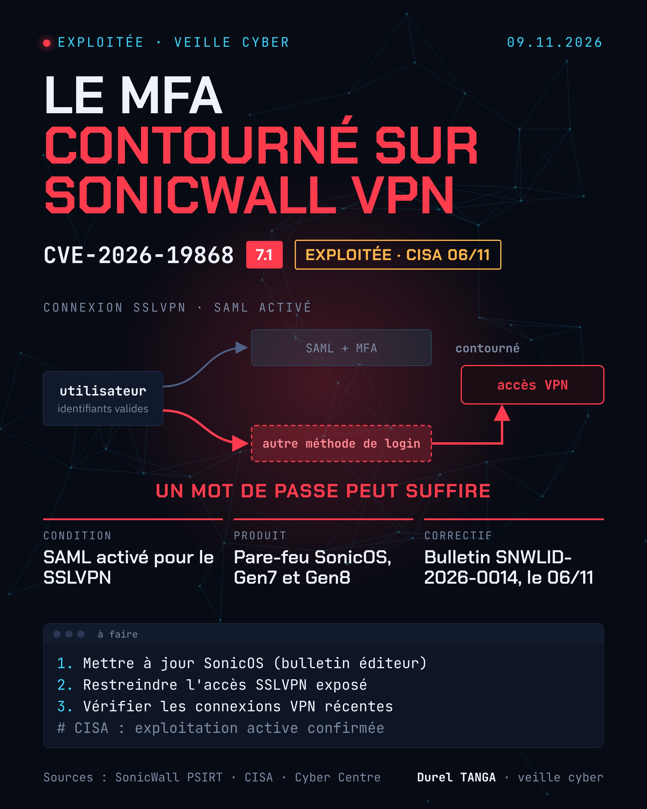

# CVE-2026-19868 : SonicOS SSLVPN, contournement du SAML et du MFA

| | |
|---|---|
| Bulletin éditeur | SNWLID-2026-0014, 06/11/2026 |
| Ajout au catalogue KEV (CISA) | 06/11/2026 |
| Sévérité (éditeur) | CVSS 7.1 |
| Produit | SonicWall SonicOS (SSLVPN) |
| Exploitation | Oui, confirmée par la CISA |

## Le problème
Le service SSLVPN n'applique pas correctement l'authentification lorsque plusieurs méthodes de connexion coexistent. Un utilisateur disposant d'identifiants valides pour une autre méthode peut contourner les contrôles SAML, y compris le MFA imposé par le SAML.

## Condition
Seuls les équipements dont le SAML est activé pour les connexions SSLVPN sont concernés par cette faille. Le même bulletin corrige six autres vulnérabilités SonicOS, la mise à jour reste donc recommandée pour tous.

## Versions concernées
Selon le Centre canadien pour la cybersécurité : SonicOS antérieur à 7.3.4-7013 et antérieur à 8.2.2-8015. Se référer au bulletin SonicWall pour les versions corrigées exactes.

## Que faire
- Mettre à jour SonicOS vers la version corrigée indiquée dans le bulletin SNWLID-2026-0014
- En attendant, limiter l'exposition du SSLVPN sur Internet (adresses sources connues)
- Examiner les journaux SSLVPN à la recherche de connexions n'étant pas passées par le fournisseur SAML
- Réinitialiser les mots de passe des comptes disposant d'une méthode de connexion alternative

## Sources
- [SonicWall PSIRT : SNWLID-2026-0014](https://psirt.global.sonicwall.com/vuln-detail/SNWLID-2026-0014)
- [CISA : catalogue KEV, CVE-2026-19868](https://www.cisa.gov/known-exploited-vulnerabilities-catalog?field_cve=CVE-2026-19868)
- [Centre canadien pour la cybersécurité : AV26-1133](https://cyber.gc.ca/en/alerts-advisories/sonicwall-security-advisory-av26-1133)
