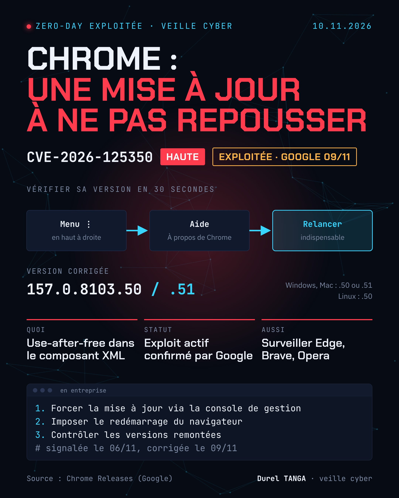

# CVE-2026-125350 : Chrome, use-after-free dans XML exploité

| | |
|---|---|
| Signalement | 06/11/2026 (chercheur anonyme) |
| Correctif Google | 09/11/2026 |
| Versions corrigées | 157.0.8103.50/.51 (Windows, Mac), 157.0.8103.50 (Linux) |
| Sévérité (Google) | Haute |
| Type | Use-after-free dans le composant XML |
| Exploitation | Oui, confirmée par Google |

## Le problème
Google indique : « Google is aware that an exploit for CVE-2026-125350 exists in the wild. » La faille, de type use-after-free, touche le composant XML du navigateur.

## Que faire
- Ouvrir le menu ⋮, puis Aide > À propos de Google Chrome
- Laisser la mise à jour se terminer, puis cliquer sur Relancer
- Vérifier que la version affichée est 157.0.8103.50 ou supérieure

En entreprise : forcer la mise à jour via la console de gestion, imposer le redémarrage du navigateur et contrôler les versions remontées par l'inventaire. Les navigateurs basés sur Chromium (Edge, Brave, Opera) sont à surveiller pour leurs propres correctifs.

## Ce que je retiens
Une mise à jour téléchargée n'est pas une mise à jour appliquée. Tant que le navigateur n'a pas redémarré, il tourne sur l'ancienne version. Sur un parc, le bon indicateur est la version réellement en cours d'exécution, pas le simple déploiement du correctif.

## Sources
- [Google : Chrome Releases, mise à jour stable du 09/11/2026](https://chromereleases.googleblog.com/2026/11/stable-channel-update-for-desktop_018223192.html)
