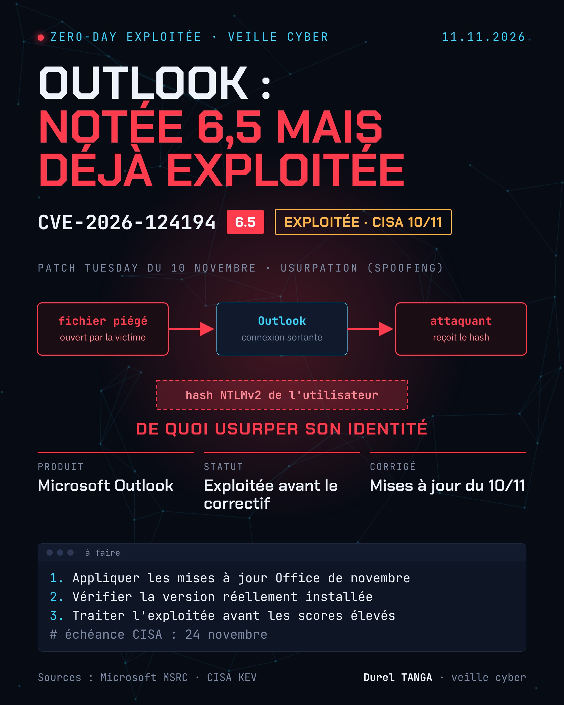

# CVE-2026-124194 : Outlook, faille d'usurpation exploitée (vol de hash NTLMv2)

| | |
|---|---|
| Publication et correctif Microsoft | 10/11/2026 |
| Sévérité (Microsoft) | Modérée, CVSS 3.1 : 6.5 |
| Type | Usurpation d'identité (CWE-356 : l'interface n'avertit pas l'utilisateur d'une action dangereuse) |
| Exploitation | Oui, exploitation détectée (Microsoft) |
| Divulguée publiquement | Non |
| Remerciements (Microsoft) | Benoît Sevens using Claude with Anthropic, nono |

## Le problème
Un attaquant non authentifié envoie un fichier de message spécialement conçu et incite l'utilisateur à l'ouvrir. Outlook se connecte alors à un emplacement réseau contrôlé par l'attaquant, sans afficher l'avertissement habituel sur le contenu externe. Le hash NTLMv2 de l'utilisateur est exposé, et l'attaquant peut s'en servir pour s'authentifier à sa place.

## Conditions
- Une interaction de l'utilisateur est nécessaire : il doit ouvrir le fichier
- Le volet de prévisualisation n'est pas un vecteur d'attaque

## Versions concernées et corrigées
| Produit | Version corrigée |
|---|---|
| Microsoft 365 Apps for Enterprise | voir https://aka.ms/OfficeSecurityReleases |
| Office LTSC 2024 | 16.0.17932.21140 |
| Office LTSC 2021 | 16.0.14334.21048 |

## Que faire
- Appliquer les mises à jour Office du 10 novembre 2026
- Vérifier le numéro de build réellement installé sur les postes
- Traiter cette faille en priorité, malgré son score modéré

## Ce que je retiens
Le score ne dit pas tout. Une faille notée 6,5 mais déjà exploitée passe avant une faille critique que personne n'utilise encore. Pour prioriser, l'exploitation réelle compte plus que la sévérité théorique.

## Sources
- [Microsoft MSRC : CVE-2026-124194](https://msrc.microsoft.com/update-guide/en-US/vulnerability/CVE-2026-124194)
- [CVE.org : CVE-2026-124194](https://www.cve.org/CVERecord?id=CVE-2026-124194)
