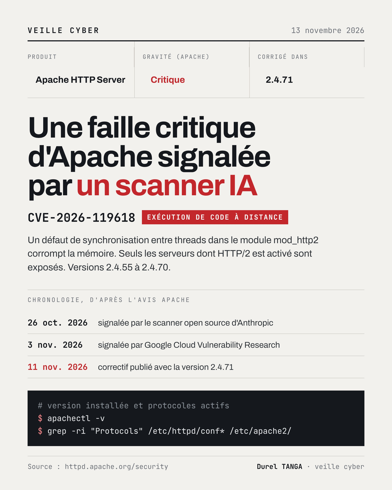

# CVE-2026-119618 : Apache HTTP Server, corruption mémoire et RCE dans mod_http2

| | |
|---|---|
| Correctif | 11/11/2026, Apache HTTP Server 2.4.71 |
| Sévérité (Apache) | Critique |
| Score (Red Hat) | CVSS 3.1 : 9.8 |
| Composant | mod_http2, fonction assign_headers() |
| Type | Accès concurrent à une ressource partagée sans synchronisation correcte |
| Exploitation | Aucune attaque signalée. Red Hat indique que des travaux publics ont démontré un exploit fiable sur une configuration par défaut |
| Signalement | 26/10/2026 par le scanner open source d'Anthropic, 03/11/2026 par Anthony Weems et Simon Scannell (Google Cloud Vulnerability Research) |

## Le problème
Plusieurs threads accèdent à une même ressource dans `assign_headers()` sans synchronisation correcte. Cela corrompt le tas et peut permettre à un attaquant distant d'exécuter du code avec les privilèges du processus du serveur web.

## Versions concernées
- Apache HTTP Server 2.4.55 à 2.4.70
- Module mod_h2 distribué séparément : 2.0.8 à 2.0.42

Seuls les serveurs dont HTTP/2 est activé via la directive `Protocols` (h2 ou h2c) sont exposés. Red Hat précise que RHEL 8 et antérieurs ne sont pas concernés, et classe la faille « importante » plutôt que critique sur RHEL 9 et 10, où chaque flux HTTP/2 utilise un allocateur distinct.

## Que faire
    # Version installée
    apachectl -v

    # HTTP/2 activé ?
    grep -ri "Protocols" /etc/httpd/conf* /etc/apache2/

Passer en 2.4.71. En attendant, retirer h2 et h2c de la directive `Protocols` supprime l'exposition, au prix de la perte d'HTTP/2.

## Ce que je retiens
Jusqu'ici j'associais surtout l'IA au camp des attaquants. Voir un scanner automatique crédité dans les remerciements d'un avis Apache, une semaine avant des chercheurs humains, me fait réviser cette idée.

## Sources
- [Apache : avis de sécurité 2.4](https://httpd.apache.org/security/vulnerabilities_24.html#CVE-2026-119618)
- [Red Hat : CVE-2026-119618](https://access.redhat.com/security/cve/cve-2026-119618)
