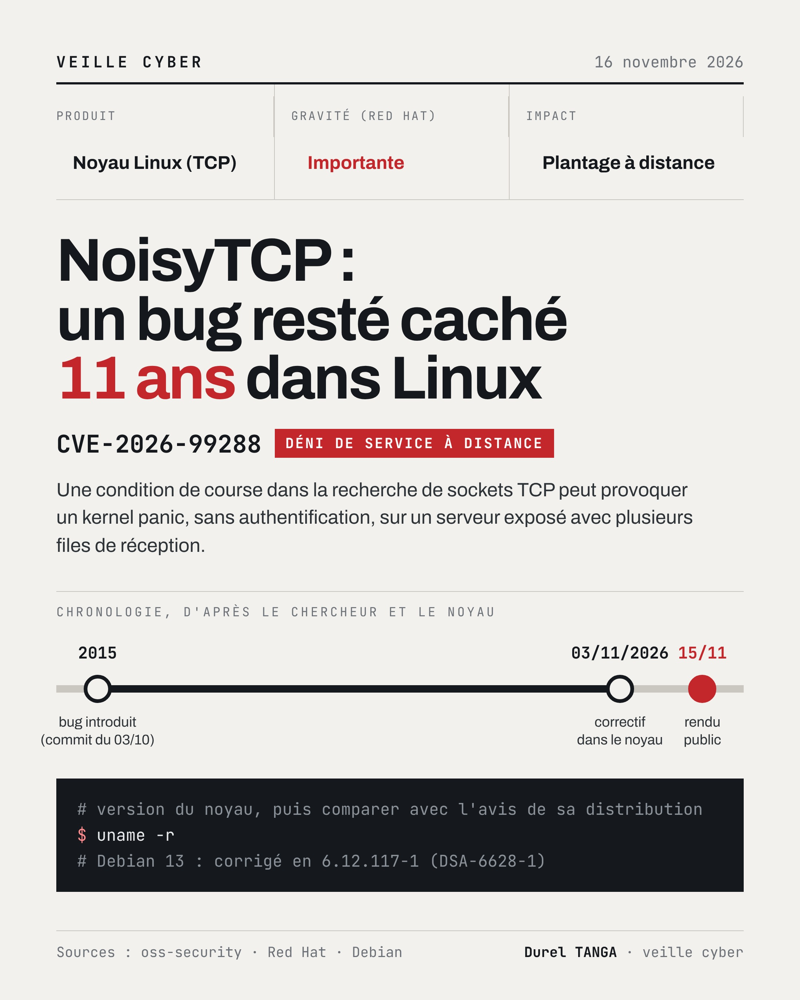

# CVE-2026-99288 (NoisyTCP) : plantage à distance du noyau Linux via TCP

| | |
|---|---|
| Bug introduit | Commit 079096f103fa, 03/10/2015 |
| Correctif dans le noyau | Commit 4e2b3ef19e0e, 03/11/2026 |
| Divulgation publique | 15/11/2026 (oss-security, Hyunwoo Kim) |
| Gravité (Red Hat) | Importante, CVSS 3.1 provisoire : 7.5 |
| Impact | Déni de service (kernel panic) |
| Exploitation | Aucune attaque signalée |

## Le problème
Les recherches de sockets TCP établies (IPv4 et IPv6) peuvent renvoyer un socket réutilisé qui n'est plus indexé. Il en résulte un déréférencement de pointeur NULL et un kernel panic. Selon le chercheur, un attaquant distant non authentifié peut le déclencher contre un serveur qui expose un service TCP (Nginx, Apache, SSH en configuration par défaut), et un hôte de conteneurs peut tomber entièrement. Le chercheur décrit aussi un second scénario menant à un use-after-free, qu'il juge difficile à déclencher ; Red Hat indique que la faille ne permet ni modification de données ni exécution de code.

## Conditions
- Un service TCP joignable par l'attaquant
- Au moins deux files de réception (RX) sur l'interface, ou RPS actif
- Délai observé par le chercheur : de 5 secondes à 2 minutes sur machine virtuelle, environ 14 heures sur un serveur physique peu chargé à 8 files de réception

## État des correctifs (Debian, au 16/11/2026)
| Version | État |
|---|---|
| Debian 13 (trixie) | Corrigé en 6.12.117-1 (DSA-6628-1) |
| Debian unstable (sid) | Corrigé en 7.3.4-1 |
| Debian 12 (bookworm) | Vulnérable |
| Debian testing (forky) | Vulnérable |

## Que faire
    # Version du noyau en cours
    uname -r

Appliquer la mise à jour du noyau publiée par sa distribution, puis redémarrer. En attendant, Red Hat et le chercheur indiquent deux contournements :
- `net.ipv4.tcp_syncookies=0`, à appliquer dans chaque espace de noms réseau (donc chaque conteneur concerné), au prix d'une protection plus faible contre les inondations SYN
- réduire à une seule file de réception l'interface exposée et désactiver RPS et RFS

## Observation
Onze ans entre l'introduction du bug et sa correction. Le délai de déclenchement, de quelques minutes en virtuel à 14 heures sur du matériel physique, explique peut-être en partie pourquoi il est passé inaperçu aussi longtemps.

## Sources
- [oss-security : annonce de Hyunwoo Kim](https://www.openwall.com/lists/oss-security/2026/11/15/2)
- [Red Hat : CVE-2026-99288](https://access.redhat.com/security/cve/cve-2026-99288)
- [Debian Security Tracker : CVE-2026-99288](https://security-tracker.debian.org/tracker/CVE-2026-99288)
- [Dépôt du chercheur](https://github.com/V4bel/NoisyTCP)
